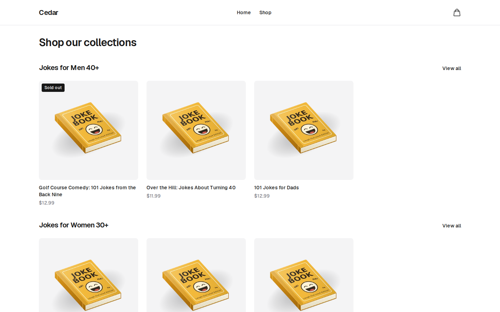
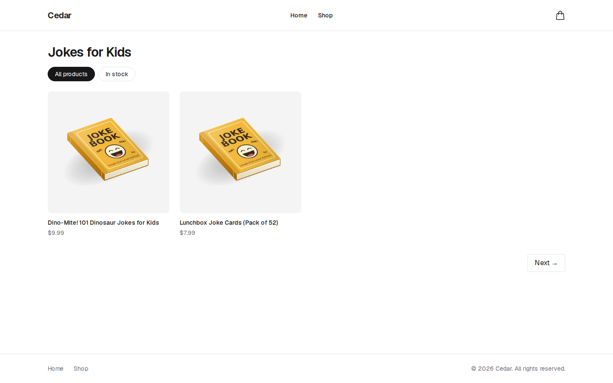
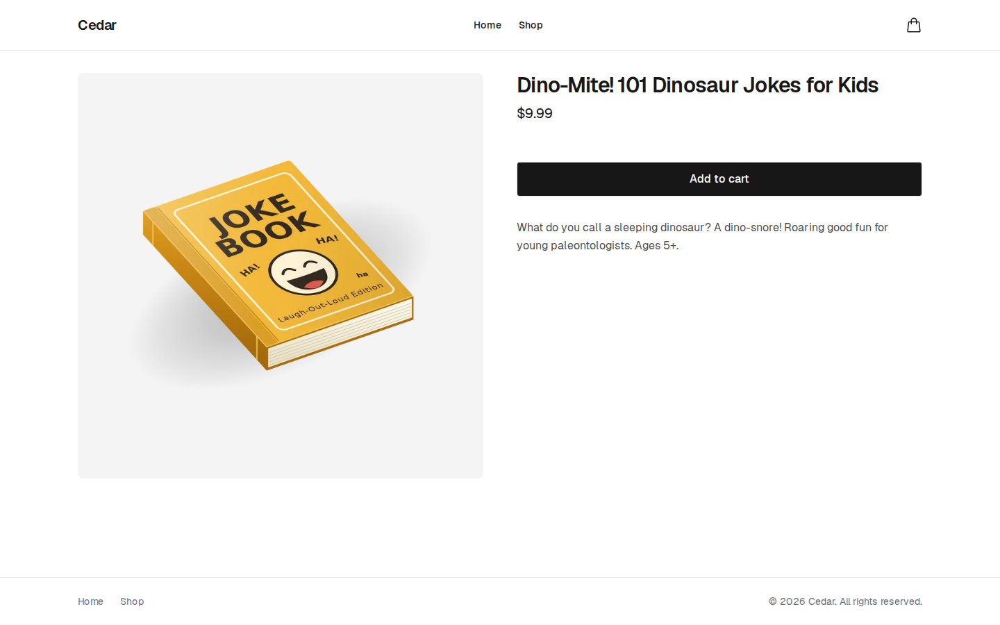
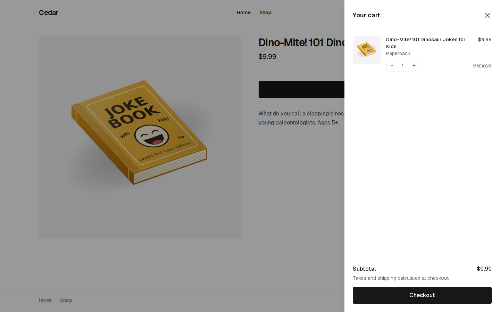
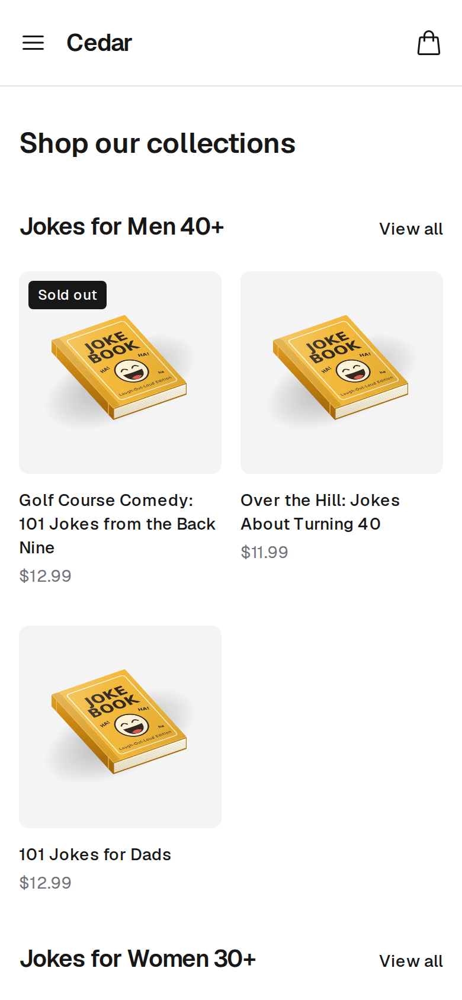

# Cedar — Headless Shopify Storefront

Cedar is a headless Shopify storefront built with Next.js (App Router), TypeScript and the Shopify Storefront API. It replaces a Liquid theme with a React front end: product data comes from Shopify over GraphQL, pages are server-rendered by Next.js, and checkout goes to Shopify's hosted checkout.

The project shows how a Shopify theme can be rebuilt as a headless storefront: typed GraphQL queries against the Storefront API, server rendering for SEO and speed, cart state handled by Shopify's own [`@shopify/hydrogen-react`](https://shopify.dev/docs/api/hydrogen-react) library, and both unit tests and end-to-end tests.

**Live demo:** [cedar-shopify-theme.vercel.app](https://cedar-shopify-theme.vercel.app)



## Features

### Shopping experience
- **Home page** with a featured collection grid
- **Collection pages** (`/collections/[handle]`) with cursor-based pagination and an in-stock / out-of-stock filter
- **Product detail pages** (`/products/[handle]`) with an image gallery, variant selection (size, colour and other options), price display and add to cart
- **Cart drawer** that slides in, with line items, quantity controls, item removal, a live subtotal and a checkout button that hands off to Shopify's hosted checkout
- **Responsive layout**, with a header, mobile navigation, a cart count badge and a footer
- **Light and dark themes** that follow the visitor's system setting

### Engineering
- **Server-side rendering** of product and collection pages, so crawlers receive fully rendered HTML
- **Typed GraphQL queries** against the Shopify Storefront API, kept in `src/lib/queries/` (see [Storefront API and GraphQL](#storefront-api-and-graphql))
- **[`@shopify/hydrogen-react`](https://shopify.dev/docs/api/hydrogen-react)** components and providers (`ShopifyProvider`, `CartProvider`, `CartLineProvider`, `Money`, `AddToCartButton`, `CartCost`, `CartCheckoutButton`) for cart state and money formatting
- **SEO and performance**: per-page metadata and Open Graph tags through the Next.js Metadata API, responsive images through `next/image` with a custom loader that resizes on Shopify's CDN, server-rendered HTML for crawlers, Lighthouse scores of 95+ on the home, collection and product pages, and GA4 page view tracking through `@next/third-parties`
- **Loading skeletons and error boundaries** for slow or failed queries (`loading.tsx`, `error.tsx` with retry, `global-error.tsx`, and a custom 404 page)

### Testing
- **Unit and component tests** with [Vitest](https://vitest.dev) and [React Testing Library](https://testing-library.com/docs/react-testing-library/intro/), covering components, cart logic and utility functions, with 100% coverage of `src/lib`
- **End-to-end tests** with [Playwright](https://playwright.dev) covering two flows: browsing to the cart, and going from the cart to checkout

## Screenshots

| Collection page | Product page |
| --- | --- |
|  |  |

| Cart drawer | Mobile |
| --- | --- |
|  |  |

## Tech stack

| Area | Technology |
| --- | --- |
| Framework | [Next.js 16](https://nextjs.org) (App Router), [React 19](https://react.dev) |
| Language | [TypeScript](https://www.typescriptlang.org) |
| Commerce | [Shopify Storefront API](https://shopify.dev/docs/api/storefront) (GraphQL), [`@shopify/hydrogen-react`](https://shopify.dev/docs/api/hydrogen-react) |
| Styling | [Tailwind CSS 4](https://tailwindcss.com) |
| Testing | [Vitest](https://vitest.dev), [React Testing Library](https://testing-library.com/docs/react-testing-library/intro/), [Playwright](https://playwright.dev) |
| Analytics | [Google Analytics 4](https://developers.google.com/analytics) through [`@next/third-parties`](https://nextjs.org/docs/app/guides/third-party-libraries) |
| Hosting | [Vercel](https://vercel.com) |

## Running locally

**Prerequisites:** Node.js 22 (see `.nvmrc`), plus a Shopify store with a [Storefront API access token](https://shopify.dev/docs/storefronts/headless/building-with-the-storefront-api/manage-headless-channels) (create one by installing the Headless channel in the Shopify admin).

```bash
git clone git@github.com:james-zedd/cedar-shopify-theme.git
cd cedar-shopify-theme
npm install
```

Create a `.env.local` file in the project root:

```bash
NEXT_PUBLIC_STORE_DOMAIN=your-store.myshopify.com
NEXT_PUBLIC_STOREFRONT_ACCESS_TOKEN=your-public-storefront-token

# Optional
NEXT_PUBLIC_GA_MEASUREMENT_ID=G-XXXXXXXXXX
SITE_URL=http://localhost:3000
```

| Variable | Required | Purpose |
| --- | --- | --- |
| `NEXT_PUBLIC_STORE_DOMAIN` | Yes | The store's `myshopify.com` domain |
| `NEXT_PUBLIC_STOREFRONT_ACCESS_TOKEN` | Yes | Public Storefront API token. It is sent to the browser, so use the public token, never a private or Admin API token. |
| `NEXT_PUBLIC_GA_MEASUREMENT_ID` | No | GA4 measurement ID. Analytics are off when it is not set. |
| `SITE_URL` | No | The site's public URL, used for canonical and Open Graph URLs and as the Playwright base URL. Defaults to `http://localhost:3000`. |

The featured collection linked from the "Shop" navigation item is set by `FEATURED_COLLECTION_HANDLE` in `src/lib/constants.ts`; change it to a collection handle in your store.

Start the dev server and open [http://localhost:3000](http://localhost:3000):

```bash
npm run dev
```

## Running tests

### Unit and component tests (Vitest)

```bash
npm test                # watch mode
npx vitest run          # run once
npm run test:coverage   # run once with a coverage report for src/lib
```

Tests live next to the code in `__tests__/` folders. Calls to the Storefront API are mocked, so these tests need no store or network access. `npm run test:coverage` fails if line, branch, function or statement coverage of `src/lib` drops below 80%, and writes an HTML report to `coverage/index.html`.

### End-to-end tests (Playwright)

Install the browser once, then run the suite:

```bash
npx playwright install chromium
npm run test:e2e
```

Playwright builds the app and starts a production server (`npm run build && npm run start`) before the tests run; if a server is already running on port 3000, it reuses that instead. The tests talk to the real store from `.env.local`, and they pick their products at run time (`e2e/store.ts`), so renaming a product or selling out a variant doesn't break them.

| Spec | What it checks |
| --- | --- |
| `smoke.spec.ts` | The home page shows collections and products from the store |
| `cart.spec.ts` | Browse from the home page to a product, select a variant, add it to the cart and see it in the cart drawer |
| `cart.spec.ts` | From the cart drawer, the checkout button sends the browser to Shopify's hosted checkout |

To run the suite against a deployed site instead, set `SITE_URL` to that site's URL.

## Storefront API and GraphQL

All store data comes from the [Shopify Storefront API](https://shopify.dev/docs/api/storefront) (version `2026-04`, set in `src/lib/constants.ts`).

### Fetching data

`src/lib/shopify.ts` exports `shopifyFetch`, a small typed helper for every server-side query. It uses hydrogen-react's `createStorefrontClient` to build the API URL and the public token headers, POSTs the query and variables, and throws if the response contains GraphQL errors, so pages can rely on `error.tsx` to show a retry state.

```ts
const data = await shopifyFetch<ProductQuery>(PRODUCT_QUERY, { handle });
```

Query strings start with `#graphql` so editors with GraphQL support highlight them. Response types are built from the official Storefront API types in `@shopify/hydrogen-react/storefront-api-types`, using `Pick` to match the fields each query asks for.

### Queries

| Query | File | Used by | Notes |
| --- | --- | --- | --- |
| `CollectionsQuery` | `queries/collection.ts` | Home page | First 4 products of each collection. Shopify's default `frontpage` collection is hidden. |
| `CollectionQuery` | `queries/collection.ts` | Collection page | Cursor-based pagination and an in-stock filter (see below) |
| `CollectionSeoQuery` | `queries/collection.ts` | Collection page metadata | SEO title and description, plus the image for Open Graph |
| `ProductQuery` | `queries/product.ts` | Product page and its metadata | Images, up to 100 variants with their options and prices, and `custom.author` / `custom.page_count` metafields |

The product card fields are defined once in a `CollectionProductFields` fragment and shared by `CollectionsQuery` and `CollectionQuery`.

### Pagination and filtering

Collection pages use the Storefront API's [cursor-based pagination](https://shopify.dev/docs/api/usage/pagination-graphql). "Next" requests `first` products `after` the current page's `endCursor`, and "Previous" requests `last` products `before` its `startCursor`. The cursors and the availability filter are kept in the URL (`?after=…`, `?before=…`, `?available=…`), so each page can be server-rendered, linked to and shared. The in-stock filter sends `filters: [{ available: true }]` to the `products` connection.

### Avoiding duplicate requests

Next.js calls `generateMetadata` and the page component separately for the same request. `getProduct` and `getCollectionSeo` are wrapped in React's [`cache`](https://react.dev/reference/react/cache), so the product page makes one Storefront API request per page load instead of two.

### Cart and checkout

The cart runs in the browser. `ShopifyProviders` wraps the app in hydrogen-react's `ShopifyProvider` and `CartProvider`. `CartProvider` creates the cart and adds, updates and removes lines through the Storefront API's cart mutations, and stores the cart ID so the cart survives a page reload. `CartCheckoutButton` sends the browser to the cart's `checkoutUrl`, Shopify's hosted checkout.

### Images

Product images are served from Shopify's CDN. `next/image` uses a custom loader (`src/lib/shopify-image-loader.ts`) that adds a `width` parameter to the CDN URL, so Shopify resizes each image and Vercel's image optimisation isn't needed.

## Project structure

```
├── docs/screenshots/   # Screenshots used in this README
├── e2e/                # Playwright end-to-end tests
└── src/
    ├── app/            # Next.js App Router routes (home, collections, products), loading and error states
    ├── components/     # UI components, with tests in __tests__/
    ├── lib/
    │   ├── queries/    # Storefront API GraphQL queries
    │   ├── shopify.ts  # Storefront API fetch helper
    │   ├── seo.ts      # Shared Open Graph metadata
    │   └── shopify-image-loader.ts  # next/image loader for Shopify's CDN
    └── providers/      # Client-side Shopify and cart providers
```

## Deployment

The site is deployed on [Vercel](https://vercel.com) from the `main` branch. Set the same environment variables as in `.env.local` in the Vercel project settings, with `SITE_URL` set to the production URL.

## Roadmap

| Feature | Status |
| --- | --- |
| Project scaffold, Storefront API connection, Vitest setup | ✅ Done |
| Home page with featured collection grid | ✅ Done |
| Collection pages with pagination and availability filter | ✅ Done |
| Product detail page with variants and add to cart | ✅ Done |
| Cart drawer and Shopify checkout | ✅ Done |
| Navigation and layout | ✅ Done |
| Manual integration test of the purchase flow and server-side rendering | ✅ Done |
| SEO and performance, including GA4 page view tracking | ✅ Done |
| Design polish, including Safari testing | ✅ Done |
| Production deploy on Vercel | ✅ Done |
| Playwright end-to-end tests | ✅ Done |
| Vitest unit tests for utility functions | ✅ Done |
| Documentation | ✅ Done |
